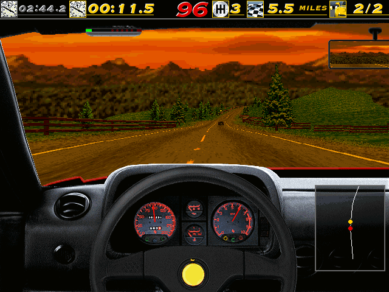
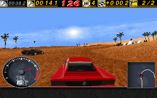
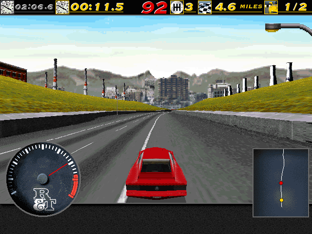
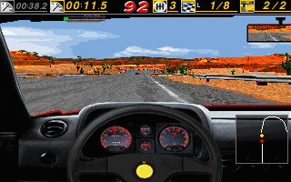

# ReNFS for MiSTer

Need for Speed SE on [MiSTer FPGA](https://github.com/MiSTer-devel/Main_MiSTer/wiki) as a hybrid port.

*The Need for Speed Special Edition* (Electronic Arts Canada, 1996, MS-DOS) through [ReNFS](https://github.com/ItsDanik/ReNFS), the game's program written again by hand from the original, and on the PC as well. The whole single-player game: every car and track, head to head, single race, time trial, tournaments, the rally, police and traffic, replays, the cars' showcase, records, saved tournaments, the original's codes, music and speech. It runs on the MiSTer's ARM CPU. The ReNFS FPGA core provides native 15kHz video (CRT, VGA and HDMI): the menus at 640x480 as in the original, the races at 320x200, 320x240, 640x200, 640x240 or 640x480; 44.1kHz audio, and keyboard, mouse and gamepad input with rumble. The two halves talk through shared DDR3 memory.


| | |
|---|---|
|  |  |
|  |  |
|  |  |
|  |  |
|  |  |

> **Beta.** Expect rough edges and please report problems in the issues.

Disclaimer: AI is being used to speed up development of this project.

## Requirements

- **danik_hybrid_ports**, the launcher (`Scripts/danik_hybrid_ports.sh`): run it **once** from the MiSTer's `Scripts` menu. It starts the game whenever its menu entry is loaded, keeps running after a reboot, and serves all our hybrid ports; its screen picks which ports and games to have, and can keep them up to date through `update_all`. It replaces `danik_hybrid_cores`, the launcher before it, and moves ports installed the old way into the new folders by itself. Without it the core says "Game not running".
- **The game's CD**, which is not included: *The Need for Speed Special Edition* for DOS / Windows 95 (1996), every file on it. Nothing has to be installed or unpacked.

## Installation

With `update_all` (Downloader 2.4 or newer, which update_all keeps up to date):

1. Copy [`downloader_danik_hybrid_ports.ini`](https://raw.githubusercontent.com/ItsDanik/Hybrid_MiSTer/main/launcher/downloader_danik_hybrid_ports.ini) to the root of your SD card (`/media/fat`).
2. Run `update_all`. That installs the launcher, **danik_hybrid_ports**, in `Scripts`.
3. Run **danik_hybrid_ports** from the `Scripts` menu, tick the games you want and press *X: Apply*. They are installed, and update_all keeps them up to date.

By hand:

1. Download the newest `ReNFS_YYYYMMDD.zip` from [releases](releases/) and extract it to the root of your SD card (`/media/fat`). That gives you:
   - `_Other/dnk-Need for Speed SE.mgl`, the game's entry in the `Other` menu
   - `_Other/dnk/dnk-ReNFS_YYYYMMDD.rbf`, the FPGA core
   - `games/dnk/ReNFS/`, the game binary and its launch script
   - `Scripts/danik_hybrid_ports.sh`, the launcher (from [Hybrid_MiSTer](https://github.com/ItsDanik/Hybrid_MiSTer))
   - `downloader_danik_hybrid_ports.ini`, with which `update_all` keeps the ports up to date from then on
2. Copy everything on the game's CD, all its files and folders as they are, into `/media/fat/games/dnk/ReNFS/NFSSE/` (so that there is `games/dnk/ReNFS/NFSSE/NFS_DOS.EXE`, `games/dnk/ReNFS/NFSSE/FRONTEND/` and so on). Upper or lower case does not matter. If files are missing, the core says which.
3. Run **danik_hybrid_ports** from the `Scripts` menu, if you have not done so before (see Requirements).
4. Load **dnk-Need for Speed SE** from the `Other` menu.

The game data can go on a USB drive instead, into the same folder there (`/media/usb0/games/dnk/ReNFS/NFSSE/`): the game looks for it there first, and then keeps its settings and saved games there as well. Everything else stays on the SD card.

The game's log is in `/media/fat/logs/dnk/ReNFS/renfs.log`. Its settings, records, saved tournaments and replays are in `games/dnk/ReNFS/saves/`.

## OSD options

| Option | |
|---|---|
| Aspect ratio, Scale, Scandoubler Fx, Stereo Mix | as in other cores |
| FPS Counter | shows the pictures per second in the top left corner |
| HDMI Only | **Yes** if no CRT is connected: resolutions of 640x400 and more are then progressive instead of interlaced, and the analog output is switched off while one is shown, so that a 15kHz screen can never get such a signal. Nothing changes at lower resolutions. Not needed with `forced_scandoubler=1` (VGA monitor); not there with `direct_video=1` |
| CRT Options | for a 15kHz screen: *Horizontal Size*, *Horizontal Pos* and *Vertical Pos* fit the picture to it. The pixels stay as they are; HDMI is not affected. The size is for the game's picture: the core's own, with its messages, keeps its width. *HUD (Bottom)* lifts the replay's bar and, from outside the car, the small rev counter and the map by that many lines, for a screen that hides its bottom edge (0 by default; at 320x240, 640x240 and 640x480: the 200-line sizes have black lines there anyway). *HUD (Top)* is greyed: the status bar stays where the game has it. Not there with `forced_scandoubler=1` |
| Resolution | the races' picture: **320x200** as the original's low resolution; **320x240** the same picture filling a 15kHz screen's 240 lines, the road and the cars drawn with all 240 of them; **640x200** and **640x240** the original's high resolution with 200 or 240 of its lines (its sharper dashboard and road, at 15kHz without interlacing); **640x480** as the original's high resolution (interlaced on a 15kHz screen). The menus are 640x480 always. Options, Graphics in the game shows the choice. From the next race |
| Smooth Motion | **On**: a new picture at every field, the cars and the camera moved on between the game's 33 steps a second; **Off**: a new picture only at each step, as the original. The game plays the same either way. Greyed out at 640x480, which the MiSTer cannot draw 60 times a second |
| Rumble | the original's force-feedback effects on the pad's motors (walls, cars, the road, gear changes, a crash): **On**, **Strong** or **Off**. A force-feedback wheel gets the original's forces |
| Cheats | the original's codes, typed in Control Central, as switches; each does what typing it does while it is on (not in a tournament, as in the original): *Mirrored Tracks* (SKCART), *Rally Tracks* (EARALLYE), *Lost Vegas* (CASINOVILLE), *Warrior Car* (CONCEPTCAR), *Unlock All* (ROCKYROAD, kept in the records once used), *Turbo* (TURBO: a faster game), *Nitro* (NITRO: R3 or N with Shift for full revs), *Explode* (EXPLODE: the horn throws the cars near you into the air), *No Mercy* (End held on head to head: no police, no traffic). On a keyboard they can still be typed |
| Save Diagnostic Report | the last line: see [If something is wrong](#if-something-is-wrong) |

## Controls

- **Keyboard and mouse:**

| Key | Action |
|---|---|
| Arrows, Enter, Esc, mouse | the menus |
| Left / Right | steer |
| Up / Down | accelerate / brake |
| A / Z | gear up / down (the automatic starts in neutral: one up to drive) |
| Space | handbrake |
| H | horn |
| C | next camera |
| M | map |
| Esc | the pause menu |
| P | pause |
| F1 .. F6 | view size, detail, road distance, sky, sound, markers |
| F7 / F8, F9 | the top bar, the bumper view |
| Shift+End | give up |
| Ctrl+Alt+1..8 | watch another car |

Options, Controls in the game changes the driving keys, as in the original.

- **Gamepad** (default mapping):

| Button | Action |
|---|---|
| Left stick | steer (analogue); the menus |
| D-pad | steer (all the way); the menus |
| A (Xbox B / PlayStation Circle) | accelerate |
| B (Xbox A / PlayStation Cross) | brake |
| R2 / L2 (RT / LT) | accelerate / brake, analogue |
| R (RB / R1) | gear up (the automatic starts in neutral: one up to drive) |
| L (LB / L1) | gear down |
| X (Xbox Y / PlayStation Triangle) | next camera |
| Y (Xbox X / PlayStation Square) | handbrake |
| Select | map |
| L3 (left stick click) | horn |
| R3 (right stick click) | nitro, with the Nitro cheat on |
| Start | the pause menu |

A racing wheel MiSTer knows steers with its wheel and drives with its pedals. Names are typed with the d-pad: up and down change the last letter, right adds one, left takes one away.

In the game's menus the buttons that confirm and go back are the ones of your MiSTer menu, whatever they do in the game: its *Menu OK* / *Menu Back* if you set them in *Define joystick buttons*, else its A / B. A controller never set up in MiSTer confirms and goes back as on its console: Cross / Circle on PlayStation, A / B on Xbox and on Nintendo.

Change the buttons in the OSD under *Define ReNFS buttons*. *Menu OK* and *Menu Back* there are only needed for a spare button without a game function. While the OSD is open, the game gets no input; a race goes on behind it (press Start for the pause menu first if you want it held).

## Building

Everything builds in Docker on a Linux PC.

```sh
git clone --recursive https://github.com/ItsDanik/ReNFS_MiSTer.git
cd ReNFS_MiSTer
./build.sh              # ARM game binary  -> build/mister/renfs
./core/build_core.sh    # FPGA core (Quartus Lite 17.0.2) -> core/output_files/ReNFS.rbf
./package.sh            # release zip      -> dist/ReNFS_YYYYMMDD.zip
```

The toolchain image (Debian bullseye, glibc 2.31 to match the MiSTer) is built from `hybrid/toolchain/` on first use. The first build also downloads and builds SDL2.

### Repository layout

| Path | |
|---|---|
| `hybrid/` | submodule: [ItsDanik/Hybrid_MiSTer](https://github.com/ItsDanik/Hybrid_MiSTer), what all our hybrid ports share: the FPGA host module, the ARM side library, SDL2 drivers, the launcher (`danik_hybrid_ports.sh`), toolchain and conventions. See its README. |
| `core/` | FPGA core, based on [Template_MiSTer](https://github.com/MiSTer-devel/Template_MiSTer): `ReNFS.sv` (OSD and button names) around `hybrid/rtl/hybrid_host.sv` |
| `renfs/` | submodule: the game, branch `mister`, with the MiSTer changes |
| `package/` | files shipped in the release next to the binary (`danik_hybrid_launch.sh`, README), and `games.txt`: the games and their menu entries |
| `releases/` | release packages |

### Development notes

- `./build.sh host` builds the same game for the PC. It runs against `hybrid/tools/fakecore`, a stand-in for the FPGA core that takes scripted input and saves screenshots and audio:
  ```sh
  gcc -O2 -o build/host/fakecore hybrid/tools/fakecore.c
  build/host/fakecore /tmp/shm script.txt audio.raw &
  cd <data folder> && MISTER_HYBRID_SHM=/tmp/shm <repository>/build/host/renfs
  ```
- `MISTER=root@<address> tools/test_on_mister.sh <id>` tries the build on a MiSTer next to what is installed there, without installing it: from `/tmp`, with the installed game's folder mirrored there (what the game writes stays in `/tmp`) and its own OSD settings. `list` and `nodata` for the core started by itself and without data, `log` for the game's log, `stop` to remove all of it again.
- `touch /tmp/renfs_nolaunch` on the MiSTer keeps the core loaded without starting the game, so you can start a development binary by hand (set `MISTER_HYBRID_CORE=ReNFS`, and `MISTER_HYBRID_SET` for a game's set name). `/tmp/danik_hybrid_ports.log` shows what the launcher daemon did.

## If something is wrong

If the game stutters, the sound breaks up or something else is wrong, open the OSD while it happens and pick **Save Diagnostic Report**, the last line of the menu. The game keeps running; MiSTer's info box says the report is saved in `games/dnk/diagnostics/` on the SD card. Send that file (`ReNFS_<date>_<time>.zip`) with a few words on what went wrong.

The report has the setup (versions, the video and audio lines of `MiSTer.ini`, the OSD settings), how the last 60 seconds went, the game's log and a screenshot. Nothing else: no network settings, addresses, saved games or lists of your files.

## Support

If you enjoy this project, you can support my work on [Patreon](https://www.patreon.com/itsdanik).

## Credits

- ***The Need for Speed SE*** by Electronic Arts Canada (1996); **[ReNFS](https://github.com/ItsDanik/ReNFS)**, its program written again.
- **[SDL](https://libsdl.org)** by Sam Lantinga and contributors.
- **[MiSTer](https://github.com/MiSTer-devel)** by Sorgelig and the MiSTer-devel contributors: the framework and Template_MiSTer.
- **[MiSTer Frontier](https://github.com/MiSTerOrganize/MiSTer_Frontier)** by MiSTer Organize: thank you for the inspiration. Hybrid cores on the MiSTer, and the way their game is launched (a daemon that watches the loaded core and runs a script from its games folder), come from MiSTer Frontier. Our launcher is a separate implementation and does not need MiSTer Frontier installed.

This project and its maintainers are in no way associated with or endorsed by Electronic Arts. The Need for Speed is a trademark of Electronic Arts. It does not include any game data.

## License

The top-level scripts, tools and documentation are licensed under the [GPL-3.0](LICENSE). The components keep their own licenses: the shared framework in `hybrid/` is GPL-3.0 except where its files say otherwise, ReNFS is GPL-3.0, SDL and the SDL drivers in `hybrid/sdl2` are zlib, the FPGA core and the MiSTer framework are GPL-2.0 (`core/LICENSE`, with the core's own sources GPL-2.0-or-later).
