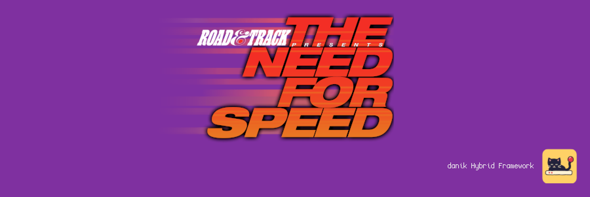
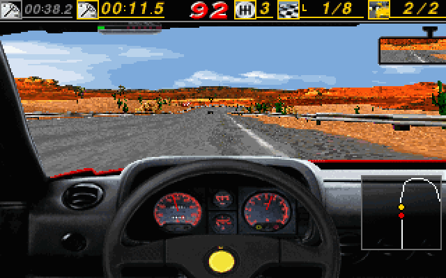

# ReNFS for MiSTer

Need for Speed SE on [MiSTer FPGA](https://github.com/MiSTer-devel/Main_MiSTer/wiki) as a hybrid port.

*The Need for Speed Special Edition* (Electronic Arts Canada, 1996, MS-DOS) through [ReNFS](https://github.com/ItsDanik/ReNFS), the game's program written again by hand from the original, and on the PC as well. The whole single-player game: every car and track, head to head, single race, time trial, tournaments, the rally, police and traffic, replays, the cars' showcase, records, saved tournaments, the original's codes, music and speech. It runs on the MiSTer's ARM CPU. The ReNFS FPGA core provides native 15kHz video (CRT, VGA and HDMI): the menus at 640x480 as in the original, the races at 320x200, 320x240, 640x200, 640x240 or 640x480; 44.1kHz audio, and keyboard, mouse and gamepad input with rumble. The two halves talk through shared DDR3 memory.

> **Beta.** Expect rough edges and please report problems in the issues.
>
> **Disclaimer:** AI is being extensively used to speed up development, but the project is well-maintained and supported.

  
  

## Requirements

- **danik_hybrid_ports**, the launcher (`Scripts/danik_hybrid_ports.sh`): run it **once** from the MiSTer's `Scripts` menu. It starts the game whenever its menu entry is loaded, keeps running after a reboot, and serves all our hybrid ports; its screen picks which ports and games to have, and can keep them up to date through `update_all`. Without it the core says "Game not running".
- **The game's CD**, which is not included: *The Need for Speed Special Edition* for DOS / Windows 95 (1996), every file on it. Nothing has to be installed or unpacked.
- **Recommended:** a gamepad with two analog sticks and analog triggers, like an Xbox or PlayStation controller. A gamepad without them works but is not recommended. The game can also be played with a keyboard and mouse.

## Installation

With `update_all` (Downloader 2.4 or newer, which update_all keeps up to date):

1. Copy [`downloader_danik_hybrid_ports.ini`](https://raw.githubusercontent.com/ItsDanik/Hybrid_MiSTer/main/launcher/downloader_danik_hybrid_ports.ini) to the root of your SD card (`/media/fat`).
2. Run `update_all`. That installs the launcher, **danik_hybrid_ports**, in `Scripts`.
3. Run **danik_hybrid_ports** from the `Scripts` menu, tick the games you want and press *X: Apply*. They are installed, and update_all keeps them up to date.
4. Copy **everything** on the game's CD, all its files and folders as they are, into `/media/fat/games/dnk/ReNFS/NFSSE/` (so that there is `games/dnk/ReNFS/NFSSE/NFS_DOS.EXE`, `games/dnk/ReNFS/NFSSE/FRONTEND/` and so on). Upper or lower case does not matter. If files are missing, the core says which.
5. Load the game from the `Other` menu, e.g. **dnk-Need for Speed SE**.

> [!NOTE]
> The game data can go on a USB drive instead, into the same folder there (`/media/usb0/games/dnk/ReNFS/NFSSE/`): the game looks for it there first, and then keeps its settings and saved games there as well. Everything else stays on the SD card.

The game's log is in `/media/fat/logs/dnk/ReNFS/renfs.log`. Its settings, records, saved tournaments and replays are in `games/dnk/ReNFS/saves/`.

## OSD options

| Option | |
|---|---|
| Aspect ratio, Scale, Scandoubler Fx, Stereo Mix | as in other cores |
| FPS Counter | shows the pictures per second in the top left corner |
| HDMI Only | **Yes** if no CRT is connected: resolutions of 640x400 and more are then progressive instead of interlaced, and the analog output is switched off while one is shown, so that a 15kHz screen can never get such a signal. Nothing changes at lower resolutions. Not needed with `forced_scandoubler=1` (VGA monitor); not there with `direct_video=1` |
| CRT Options | **Horizontal Size**: the picture's width **Horizontal Pos**: moves it left or right **Vertical Pos**: moves it up or down **HUD (Top)**: always greyed out, the status bar stays where the game has it **HUD (Bottom)**: lifts the replay's bar, the small rev counter and the map 0 to 24 lines off the bottom edge (default 0), at 320x240, 640x240 and 640x480  For a 15kHz screen: fits the picture to it and keeps the HUD out of the overscan. HDMI is not affected; not there with `forced_scandoubler=1` |
| Resolution | **320x200**: the original's low resolution (default) **320x240**: the same, the road and the cars drawn with all 240 lines **640x200**: the original's high resolution in 200 lines **640x240**: the same in 240 lines **640x480**: the original's high resolution, interlaced at 15kHz  The races' picture; the menus are always 640x480. Options, Graphics in the game shows the choice. From the next race |
| Smooth Motion | **On**: a new picture every field, moved on between the game's 33 steps a second (default) **Off**: a new picture at each step, as the original  The game plays the same either way. Greyed out at 640x480, which the MiSTer cannot draw 60 times a second |
| Rumble | **On**: the original's force-feedback effects on the pad's motors (default) **Strong**: the same, stronger **Off**: none  Walls, cars, the road, gear changes, a crash. A force-feedback wheel gets the original's forces |
| Cheats | **Mirrored Tracks**: the tracks mirrored (SKCART) **Rally Tracks**: the rally tracks (EARALLYE) **Lost Vegas**: the Lost Vegas track (CASINOVILLE) **Warrior Car**: the Warrior car (CONCEPTCAR) **Unlock All**: everything unlocked, kept in the records (ROCKYROAD) **Turbo**: a faster game (TURBO) **Nitro (R3)**: R3 or Shift+N for full revs (NITRO) **Explode (Horn)**: the horn throws nearby cars into the air (EXPLODE) **No Mercy**: no police and no traffic in head to head  The original's codes as switches, each doing what typing it in Control Central does, not in a tournament. On a keyboard they can still be typed |
| Save Diagnostic Report | the last line: see [If something is wrong](#if-something-is-wrong) |

## Controls

- **Keyboard and mouse:**

| Key | Action |
|---|---|
| Arrows, Enter, Esc, mouse | the menus |
| Left / Right | steer |
| Up / Down | accelerate / brake |
| A / Z | gear up / down (the automatic starts in neutral: one up to drive) |
| Space | handbrake |
| H | horn |
| C | next camera |
| M | map |
| Esc | the pause menu |
| P | pause |
| F1 .. F6 | view size, detail, road distance, sky, sound, markers |
| F7 / F8, F9 | the top bar, the bumper view |
| Shift+End | give up |
| Ctrl+Alt+1..8 | watch another car |

- **Gamepad** (default mapping):

| Button | Action |
|---|---|
| Left stick | steer (analogue); the menus |
| D-pad | steer (all the way); the menus |
| A (Xbox B / PlayStation Circle) | accelerate |
| B (Xbox A / PlayStation Cross) | brake |
| R2 / L2 (RT / LT) | accelerate / brake, analogue |
| R (RB / R1) | gear up (the automatic starts in neutral: one up to drive) |
| L (LB / L1) | gear down |
| X (Xbox Y / PlayStation Triangle) | next camera |
| Y (Xbox X / PlayStation Square) | handbrake |
| Select | map |
| L3 (left stick click) | horn |
| R3 (right stick click) | nitro, with the Nitro cheat on |
| Start | the pause menu |
| Racing wheel | steer with the wheel, drive with the pedals (a wheel MiSTer knows) |

Change the buttons in the OSD under *Define ReNFS buttons*. *Menu OK* and *Menu Back* there are only needed for a spare button without a game function. While the OSD is open, the game gets no input.

> [!WARNING]
> A button left without a name in *Define ReNFS buttons* does not reach the game at all, except L2/R2, L3/R3 and *Menu OK* / *Menu Back*. Name every button there, or leave the definition as it is. To go back to the default buttons, delete `config/inputs/ReNFS_input_*_v3.map` on the SD card.

Typing a name without a keyboard: up/down changes the last letter, right adds one, left takes one away.

## If something is wrong

If the game stutters, the sound breaks up or something else is wrong, open the OSD while it happens and pick **Save Diagnostic Report**, the last line of the menu. The game keeps running; MiSTer's info box says the report is saved in `games/dnk/diagnostics/` on the SD card. Send that file (`ReNFS_<date>_<time>.zip`) with a few words on what went wrong.

The report has the setup (versions, the video and audio lines of `MiSTer.ini`, the OSD settings), how the last 60 seconds went, the game's log and a screenshot. Nothing else: no network settings, addresses, saved games or lists of your files.

## Building

How the port works, how to build it and notes for development: [NOTES.md](NOTES.md).

## Support

If you enjoy this project, you can support my work on [Patreon](https://www.patreon.com/itsdanik).

## Credits

- ***The Need for Speed SE*** by Electronic Arts Canada (1996); **[ReNFS](https://github.com/ItsDanik/ReNFS)**, its program written again.
- **[SDL](https://libsdl.org)** by Sam Lantinga and contributors.
- **[MiSTer](https://github.com/MiSTer-devel)** by Sorgelig and the MiSTer-devel contributors: the framework and Template_MiSTer.
- **[MiSTer Frontier](https://github.com/MiSTerOrganize/MiSTer_Frontier)** by MiSTer Organize: thank you for the inspiration. Hybrid cores on the MiSTer, and the way their game is launched (a daemon that watches the loaded core and runs a script from its games folder), were inspired by MiSTer Frontier.

This project and its maintainers are in no way associated with or endorsed by Electronic Arts. The Need for Speed is a trademark of Electronic Arts. It does not include any game data.

## License

The top-level scripts, tools and documentation are licensed under the [GPL-3.0](LICENSE). The components keep their own licenses: the part of the shared framework the game is linked with (`hybrid/hps/`) is GPL-2.0-or-later, the rest of `hybrid/` GPL-3.0 except where its files say otherwise, ReNFS is GPL-3.0, SDL and the SDL drivers in `hybrid/sdl2` are zlib, the FPGA core and the MiSTer framework are GPL-2.0 (`core/LICENSE`, with the core's own sources GPL-2.0-or-later).
